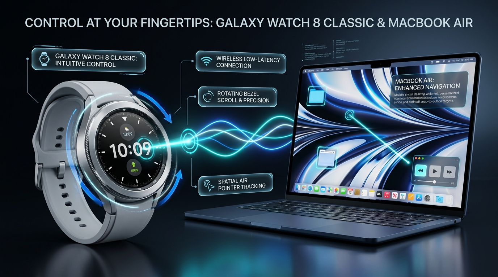

# ⌚ Galaxy Watch to Mac Air Controller

[](https://github.com/Happy123455/GalaxyMacController)
[](https://github.com/Happy123455/GalaxyMacController)
[](https://opensource.org/licenses/MIT)

<p align="center">
  
</p>

Transform your **Samsung Galaxy Watch** (Wear OS 4 / 5 / Galaxy Watch 4, 5, 6, 7, 8 Ultra/Classic) into a high-precision, low-latency **Air Controller & Spatial Mouse** for your **Mac**.

Built with real-time IMU sensor fusion, DSP anti-tremor filtering, macOS Accessibility magnetic button snapping, physical bezel rotary wheel decoding, and wrist-twist 3D scrolling.

---

## ✨ Features & Gesture Map

| Gesture / Input | macOS Action | Mechanism |
| :--- | :--- | :--- |
| **Move Arm** | **Air Mouse Pointer** | 60 FPS Gyroscope & Linear Acceleration fusion with low-pass EMA tremor suppression |
| **🧲 Button Snapping** | **Magnetic Cursor Lock** | macOS Accessibility API (`AXUIElement`) detects button boundaries and snaps cursor to center |
| **⏱️ 1-Sec Dwell** | **Auto Left Click** | Stationary hover for $\ge 1.0\text{s}$ executes left click without any hand movement |
| 🤏🤏 **Double Pinch** | **Left Click** | Two rapid thumb + index taps (cadence window filtered to avoid flesh recoil bounce) |
| 🤏🤏🤏 **Triple Pinch** | **Right Click** | Three rapid pinches opens context menus |
| 🤏 **Single Pinch** | *(Ignored)* | Single taps are filtered out to prevent accidental misclicks |
| ✊ **Violent Shake** | **Grab / Drag & Select Toggle** | High-acceleration burst ($\ge 17.5\text{ m/s}^2$) toggles left-click hold down for grabbing windows/files |
| 🌀 **Wrist Roll (Clockwise)** | **Scroll Down** | Twist wrist to the right (supination) for fluid continuous downward scrolling |
| 🌀 **Wrist Roll (Anti-Clockwise)** | **Scroll Up** | Twist wrist to the left (pronation) for fluid continuous upward scrolling |
| ⚙️ **Physical Rotating Bezel** | **Precision Stepped Scroll** | Wear OS rotary encoder event mapped to native macOS session scroll wheel |

---

## 🏗️ Architecture

```
┌─────────────────────────────────────────────────────────┐
│              Samsung Galaxy Watch (Wear OS)             │
│  - Jetpack Compose UI with Hardware Rotary Interceptor   │
│  - Gyroscope & Linear Acceleration at 60 Hz             │
│  - 3D Rotation Vector & Dynamic Neutral Baseline        │
│  - DSP Pulse Segmentation & Debounce Cadence Window     │
└────────────────────────────┬────────────────────────────┘
                             │  High-Speed UDP Packets (<4ms latency)
                             ▼
┌─────────────────────────────────────────────────────────┐
│                   macOS Host Companion                  │
│  - Background Daemon via LaunchAgent (auto-starts)     │
│  - Native HID Event Injection via pynput & Quartz       │
│  - Accessibility API (AXUIElement) Sticky Buttons       │
│  - 1-Second Dwell Auto-Clicker                          │
│  - Local Neural Studio Dashboard (http://localhost:8766) │
└─────────────────────────────────────────────────────────┘
```

---

## 🚀 Getting Started

### 1. macOS Companion Setup

#### Prerequisites
- macOS 13+ (Ventura, Sonoma, Sequoia)
- Python 3.10+
- `pip install -r mac-server/requirements.txt`

#### Quick Start (Foreground)
```bash
cd mac-server
python3 mac_controller_server.py
```

#### Install as Silent Background Service (Auto-starts on Mac login)
```bash
cd mac-server
./install_service.sh
```
> To uninstall later: `./uninstall_service.sh`

#### ⚠️ macOS Accessibility Permissions
1. Open **System Settings** > **Privacy & Security** > **Accessibility**.
2. Ensure **Python** (or **Terminal** if running directly) is toggled **ON** 🟢.
   *(macOS requires accessibility permission to dispatch native clicks and scroll events to other applications).*

---

### 2. Galaxy Watch App Setup

#### Prerequisites
- Android Studio Ladybug or newer / Android SDK command-line tools
- Galaxy Watch connected to the same Wi-Fi network as your Mac

#### Option A: Build & Deploy via ADB (Quickest)
1. Enable **Developer Options** and **Wireless Debugging** on your watch.
2. Pair & connect your Mac to the watch over ADB:
   ```bash
   adb connect <WATCH_IP>:<WATCH_PORT>
   ```
3. Build and install:
   ```bash
   cd wear-os-app
   ./gradlew assembleDebug
   adb install -r app/build/outputs/apk/debug/app-debug.apk
   ```

#### Option B: Android Studio
1. Open the `wear-os-app/` directory in Android Studio.
2. Select your Galaxy Watch target from the device dropdown.
3. Click **Run** ▶️.

The watch app automatically discovers your Mac over local Wi-Fi UDP broadcast.

---

## 🧠 Neural Studio Web Dashboard

When the Mac server is running, open:
```text
http://localhost:8766
```
- Real-time gesture waveform oscilloscope
- PyTorch 1D-CNN tap classifier confidence
- Live sensor telemetry & click inspection

---

## 🛠️ Configuration & Customization

Inside the Watch App settings page or `AppSettings.kt`:
- **Pinch Sensitivity Threshold**: Calibrate trigger force ($2.0 - 6.0\text{ m/s}^2$).
- **Aiming Mode**: Automatically drops cursor speed to $0.2\times$ sniper precision when moving slowly over small buttons.
- **Wrist Roll Deadzone**: Configurable tilt threshold ($12^\circ - 18^\circ$).
- **Dwell Timer**: Configurable hover duration for auto-click (default: $1.0\text{s}$).

---

## 📄 License

This project is licensed under the [MIT License](LICENSE) - see the LICENSE file for details.
